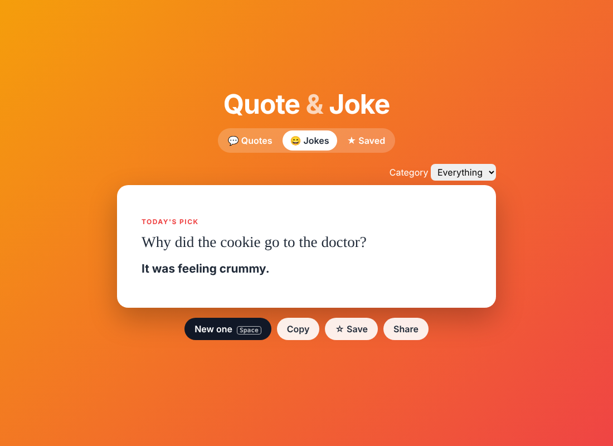
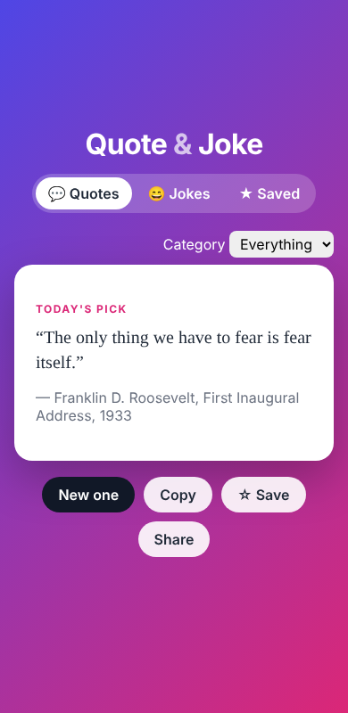

# Quote & Joke Generator

**▶ [Live demo](https://theoyanvno.github.io/quote-and-joke-generator/)**

A quick pick-me-up: switch between inspiring **quotes** and clean **jokes**, filter by category, save your favorites, and share them.

**Tech:** JavaScript (ES modules) · HTML/CSS · `localStorage` · `node:test` · no frameworks

| Jokes | Quotes on a phone |
|---|---|
|  |  |

## Features

- **Quotes** from thinkers and leaders, each with its author and source (book, speech or year)
- **Jokes** with a setup first, then a button to reveal the punchline. Categories include tech, dad jokes, science, medical and military.
- **Today's pick**: the same quote and joke all day for everyone, a new one tomorrow
- Never shows the same item twice in a row
- Typewriter animation and a card flip on each new item (turned off automatically for reduced-motion users)
- **Save** favorites (kept in your browser), **copy** to the clipboard, or **share** to X/Twitter
- Keyboard shortcut: press **Space** for a new one, or to reveal the punchline

## How it works

| File | What it does |
|---|---|
| [`src/data.js`](src/data.js) | The quotes and jokes, with categories |
| [`src/picker.js`](src/picker.js) | Pure functions: random pick without repeats, date-seeded daily pick, filtering, formatting |
| [`src/app.js`](src/app.js) | Tabs, animations, saving favorites and keyboard shortcuts |

## Run it

```bash
python3 -m http.server 8000      # then open http://localhost:8000
npm test                         # 5 tests
```

## Add your own

Add an object to `QUOTES` or `JOKES` in `src/data.js`. New categories (tags) appear in the filter automatically.

The quotes come from public-domain works and speeches; the jokes were written for this project.

Built with help from AI coding tools for planning, code review and tests.
