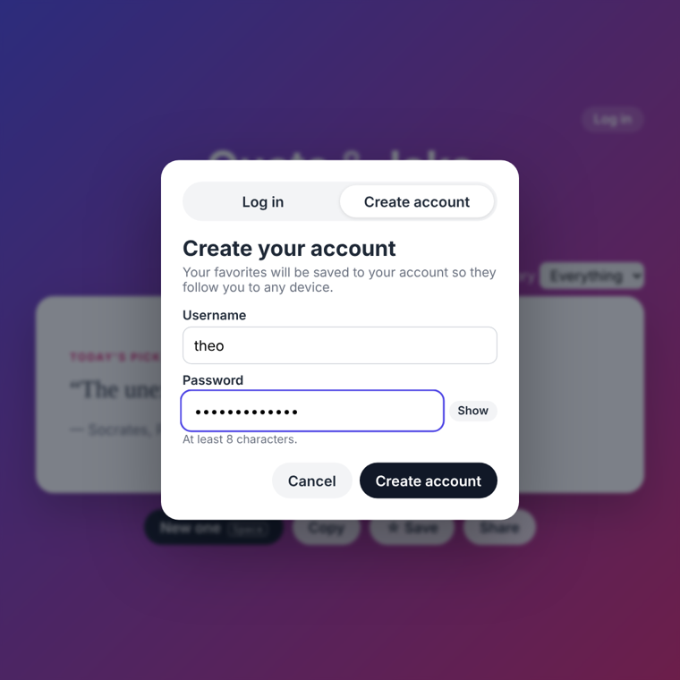
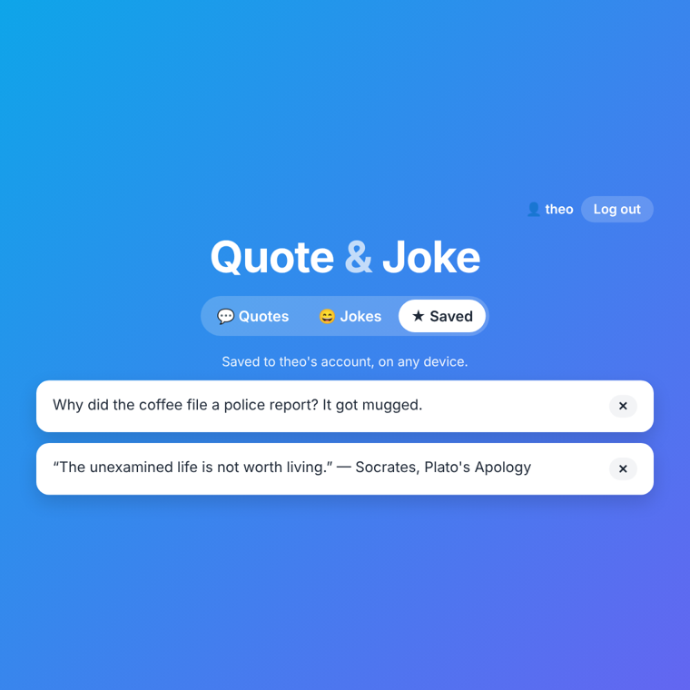

# Quote & Joke Generator

**▶ [Live demo](https://theoyanvno.github.io/quote-and-joke-generator/)**

A quick pick-me-up: switch between inspiring **quotes** and clean **jokes**, filter by category, save your favorites, and share them. Create an account and your favorites follow you to any device.

**Tech:** JavaScript (ES modules) · HTML/CSS · Node.js (`node:http`, `node:sqlite`, `node:crypto`) · SQL · IndexedDB · `node:test` · no frameworks or packages

| Jokes | Quotes on a phone |
|---|---|
|  |  |
| **Create an account** | **Favorites saved to the account** |
|  |  |

## Features

- **Quotes** from thinkers and leaders, each with its author and source (book, speech or year)
- **Jokes** with a setup first, then a button to reveal the punchline. Categories include tech, dad jokes, science, medical and military.
- **Today's pick**: the same quote and joke all day for everyone, a new one tomorrow
- Never shows the same item twice in a row
- Typewriter animation and a card flip on each new item (turned off automatically for reduced-motion users)
- **Save** favorites (kept in your browser), **copy** to the clipboard, or **share** to X/Twitter
- Keyboard shortcut: press **Space** for a new one, or to reveal the punchline
- **Accounts:** sign up, log in and log out. Logged in, favorites are saved to your account; anything you saved before logging in moves into it automatically.

## Accounts

The Node server (`npm start`) adds real accounts:

| Piece | How |
|---|---|
| Passwords | Hashed with **scrypt** and a random 16-byte salt per user (`server/crypto.js`); checked with a constant-time compare. The password itself is never stored. |
| Sessions | A random 256-bit token in an **HttpOnly, SameSite=Lax** cookie. Page scripts can't read it, and other sites can't send it. The database stores only a SHA-256 hash of the token, and logging out deletes it. Sessions last 30 days. |
| Brute force | After 5 wrong passwords for a username, logins are locked for 15 minutes (`429` with `Retry-After`). Each IP is also limited to 30 login/sign-up requests per 10 minutes. Unknown usernames get the same message and take the same time as wrong passwords. |
| Cross-site requests | Changes must be JSON (`415` otherwise), and requests from another site's `Origin` are refused (`403`). |
| SQL | `node:sqlite` with prepared statements (`?` placeholders). `UNIQUE` usernames (case-insensitive) and `UNIQUE (user_id, text)` favorites, `ON CONFLICT DO NOTHING` for duplicates, `ON DELETE CASCADE` from users ([`sql/schema.sql`](sql/schema.sql)). |
| Files | Only the app's own files are served; the database, server code and tests return 404. Security headers include a Content Security Policy. |

### API

| Method | Endpoint | Description |
|---|---|---|
| POST | `/api/signup` | `{ username, password }` → `201` and a session cookie |
| POST | `/api/login` | `{ username, password }` → session cookie, or `401` / `429` |
| POST | `/api/logout` | Ends the session and clears the cookie |
| GET | `/api/me` | `{ user }` or `{ user: null }` |
| GET | `/api/favorites` | The signed-in user's favorites (`401` if not signed in) |
| POST | `/api/favorites` | `{ text, kind: "quote" \| "joke" }` |
| POST | `/api/favorites/import` | `{ items: [...] }`: favorites saved before logging in |
| DELETE | `/api/favorites/:id` | Remove one (only your own) |

### The live demo

GitHub Pages can only host files, so there's no server for the [live demo](https://theoyanvno.github.io/quote-and-joke-generator/). Instead, the **same** account service and API routes run inside the browser ([`src/accounts/browser-store.js`](src/accounts/browser-store.js)), saving demo accounts in IndexedDB and hashing passwords with PBKDF2 from the Web Crypto API (scrypt isn't available in browsers). The page labels this as a **demo**: accounts exist only in that browser, and the session token can't be HttpOnly without a server. Run `npm start` for the real thing.

One code path for both is possible because the routes are a plain function, `handleApi(service, request) → { status, body, session }`, and the service only needs a storage object with the same methods (`server/sqlite-store.js` or `browser-store.js`).

## How it works

| File | What it does |
|---|---|
| [`src/data.js`](src/data.js) | The quotes and jokes, with categories |
| [`src/picker.js`](src/picker.js) | Pure functions: random pick without repeats, date-seeded daily pick, filtering, formatting |
| [`src/app.js`](src/app.js) | Tabs, animations, favorites, the log-in dialog and keyboard shortcuts |
| [`src/api.js`](src/api.js) | Uses the Node server when there is one, otherwise the in-browser demo |
| [`src/accounts/service.js`](src/accounts/service.js) | Account rules: sign up, log in, sessions, lockout, favorites |
| [`src/accounts/routes.js`](src/accounts/routes.js) | The REST API as one function, shared by the server and the demo |
| [`server/`](server) | `node:http` server, SQLite storage, scrypt and tokens |

## Run it

```bash
npm start                        # Node 22.13+: app and accounts at http://localhost:3000 (saves to quotes.db)
npm test                         # 27 tests: picker, account rules, HTTP API, and the browser demo
python3 -m http.server 8000      # or just the files, with demo accounts, at http://localhost:8000
```

Settings: `PORT` (default 3000), `DB` (database file), and `COOKIE_SECURE=1` when serving over HTTPS.

## Add your own

Add an object to `QUOTES` or `JOKES` in `src/data.js`. New categories (tags) appear in the filter automatically.

The quotes come from public-domain works and speeches; the jokes were written for this project.

Built with help from AI coding tools for planning, code review and tests.
